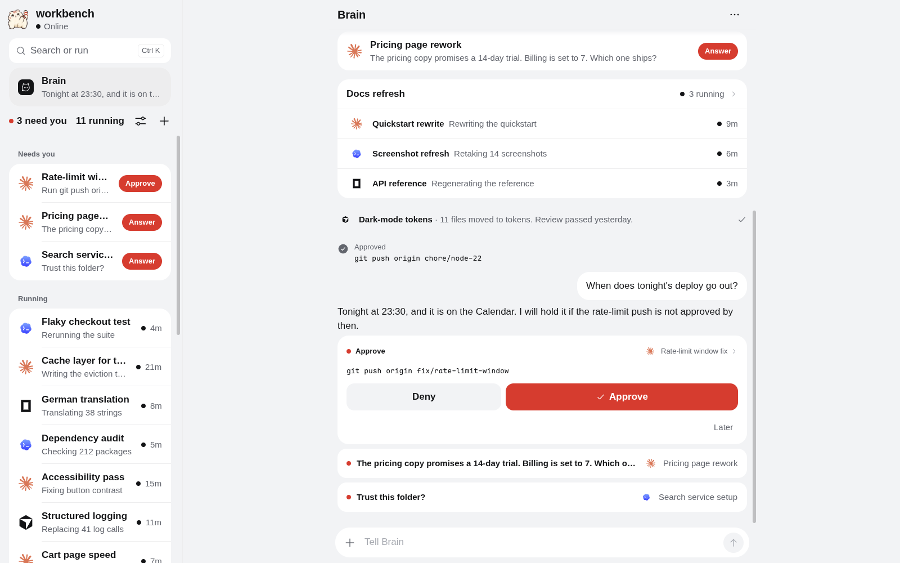
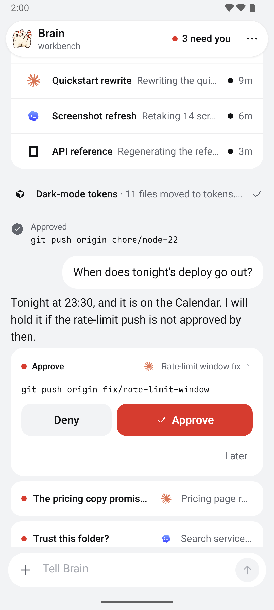
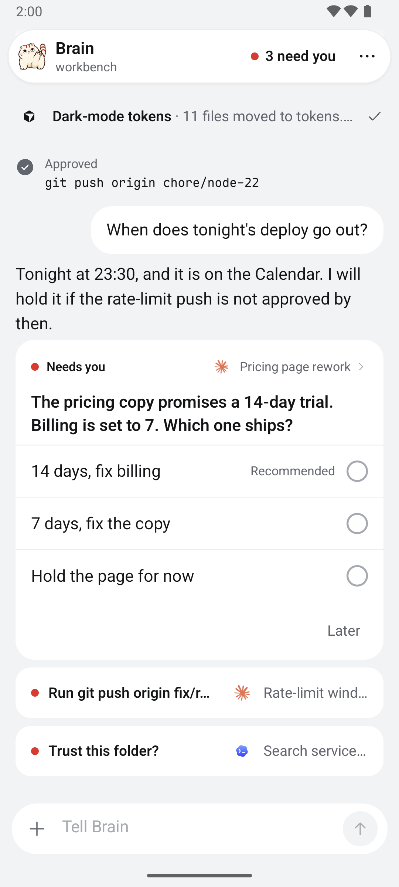
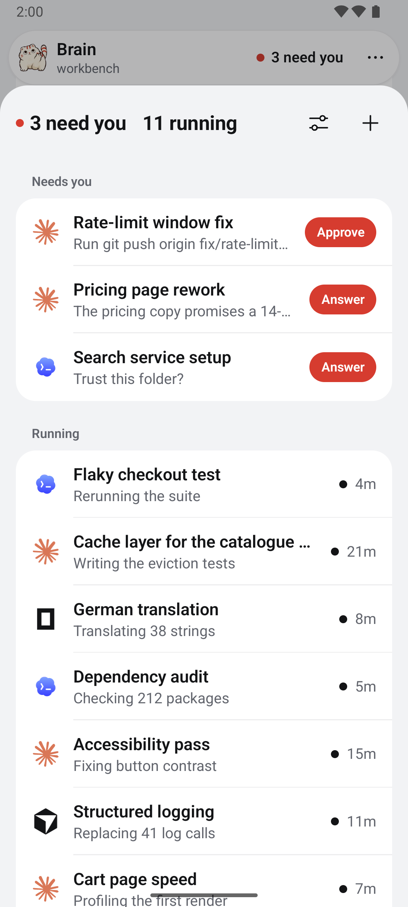
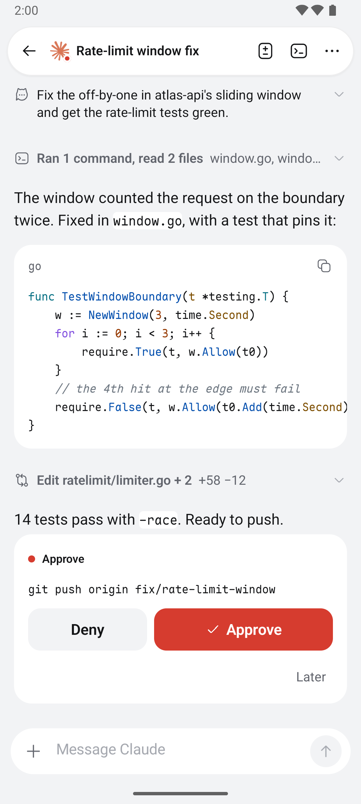
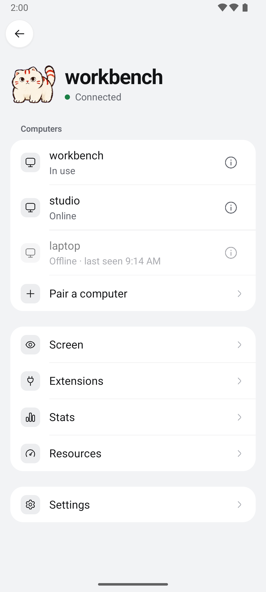
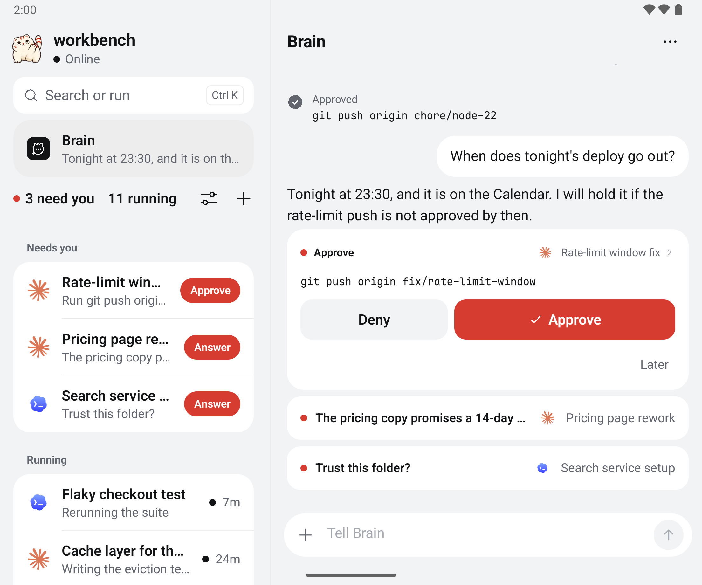

# Mewla

Naps all day. Ships all night.

An open-source app that leads a team of AI coding agents (Claude Code, Codex, Pi and others) on your own computer. Tell Brain the goal, and it calls you only when it matters. Its app for iPhone, Android and the web is one Native Shell app: native views on the phone, the same TSX in the browser.

## One question. Answer it anywhere.

On the lock screen, in the tray or in the chat. Answer once and it's answered everywhere.

## Everything running, two taps away.

Each agent works in a real terminal on your computer: Claude Code, Codex, Cursor, Grok, Pi or OpenCode. Read it as a chat, or take the keyboard.

## Hands on your computers.

Agents use the apps on your Mac, Windows PC or Linux box, and your Android phone. Watch, or take over.

## Phone, foldable, browser. One app.

Open it wide and what's running stays on the left.

[Website](https://mewla.ai) · [GitHub repository](https://github.com/daoleno/mewla)
